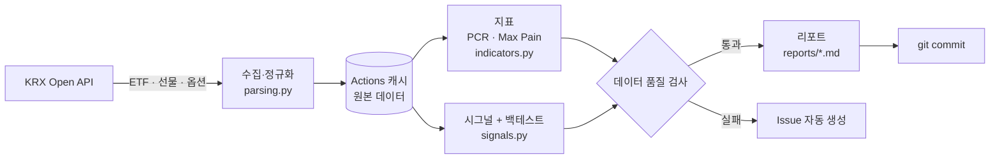

# KRX 데일리 리포트

[](https://github.com/yoonjb020927/krx-daily-report/actions/workflows/ci.yml)
[](https://github.com/yoonjb020927/krx-daily-report/actions/workflows/daily-report.yml)

한국거래소(KRX) Open API에서 ETF 일별 매매정보와 코스피200 선물·옵션 데이터를 받아,

- ETF 매매 시그널을 **백테스트로 검증하고 통과한 시그널만** 매매 후보로 올리고
- 옵션 **PCR**(풋/콜 비율)과 **Max Pain**, 선물 베이시스를 함께 보여 주는

일일 리포트를 **GitHub Actions로 매 영업일 아침 자동 생성**합니다. 서버 없이 GitHub만으로 수집, 계산, 기록, 알림까지 처리합니다.

- 📄 리포트: [`reports/`](reports/) (2025-11-24부터 영업일마다 1개)
- 📈 지표 추이: [`summary.csv`](summary.csv)

## 리포트 예시 (2026-11-23)

| 항목 | 값 | 비고 |
|---|---|---|
| 코스피200 선물(최근월) | 726.65 | 베이시스 -4.18 |
| PCR (거래량 / 미결제약정) | 0.94 / 1.32 | 풋 69,864 / 콜 74,215 |
| Max Pain | 835.0 | 12월물 기준, 선물 대비 +108.4 |

| 시그널 | 초과수익 | t값 | 최근 30% 초과수익 | 평균 수익 | 채택 |
|---|---|---|---|---|---|
| 거래대금 급증 + 상승 | -0.38% | -0.85 | -1.46% | +0.36% | ❌ |
| 5일선 > 20일선 돌파 | +0.21% | 0.36 | +0.32% | +0.20% | ❌ |
| 20일 신고가 돌파 | +0.11% | 0.33 | +0.47% | +0.34% | ❌ |

거래대금 급증 시그널은 평균 수익만 보면 +0.36%지만, 같은 날 ETF 전체를 산 것보다 0.38% 못합니다. 아래 [시그널 검증 방법](#시그널-검증-방법)이 이런 착시를 걸러 냅니다.

## 구조



| 모듈 | 역할 |
|---|---|
| `krx_client.py` | API 호출, 재시도, 401/403 안내 |
| `parsing.py` | `"1,234"` 같은 문자열을 숫자로 변환, 옵션 종목명에서 행사가·만기·콜풋·세션 추출 |
| `indicators.py` | PCR, Max Pain, 최근월 선물, 이상치 검사 |
| `signals.py` | 시그널 3종, 초과수익 백테스트 |
| `storage.py` | 하루 한 파일(`data/<종류>/<연도>/<날짜>.csv.gz`), 휴장일 기록 |
| `pipeline.py` | 수집 → 저장 → 계산 → 출력, 과거 리포트 재생성 |
| `.github/workflows/` | `daily-report`(평일 09:17 KST, 12:47 재시도), `backfill`(수동), `ci`(push마다 테스트) |

## 실제 데이터에서 찾아 고친 문제들

가짜 데이터로 만든 테스트는 모두 통과했지만, 실제 KRX 응답을 넣자 아래 문제가 나왔습니다. 각 문제는 원인을 확인해 고쳤고, 같은 상황을 재현하는 테스트와 자동 검사를 함께 넣었습니다.

| 증상 | 원인 | 수정 |
|---|---|---|
| 옵션 행이 예상의 2배, 미결제약정 이중 집계 | 파생상품은 같은 종목이 정규장 `(정규)`/`(주간)`과 야간장 `(야간)`으로 두 번 들어옴 | 종목명에서 세션을 구분해 정규장만 사용 |
| Max Pain 450 (선물 752) | 행사가 1,000 이상은 종목명이 `1,002.5`처럼 쉼표 포함 → 정규식이 `1`만 읽어 3,888행이 행사가 1.0으로 뭉침 | 쉼표 포함 숫자 파싱, **(만기, 행사가, 콜/풋) 중복 시 리포트 차단** |
| 3년 백필이 785일 (영업일은 약 731일) | KRX는 휴장일에 빈 응답이 아니라 **가격만 빈 종목 목록**을 보냄 → 휴장일 54일이 영업일로 저장 | 종가가 있는 날만 영업일로 판단, 휴장일 기록 |
| 매달 둘째 목요일 Max Pain이 최저 행사가 | 만기일에는 만기 월물의 미결제약정이 0으로 나옴 | 미결제약정이 남은 가장 가까운 만기 사용 |
| 시그널 평균 수익이 모두 플러스 | 3년간 코스피200이 2배 넘게 오른 상승장 효과 | 같은 날 ETF 전체 매수 대비 **초과수익**으로 판정 |
| 거래량 PCR 9.96 (2026-06) | 실제 값 (상승장 고점의 풋 매수 급증) | 이상치 상한을 10에서 20으로 조정 |

또, 미니·위클리 옵션이 같은 응답에 섞여 PCR이 비정상적으로 커지는 경우를 막도록 상품명(`코스피200 옵션`)으로 필터링하고, PCR이 0.05~20을 벗어나면 리포트를 발행하지 않습니다.

## 시그널 검증 방법

- **진입·청산**: t일 종가까지의 정보로 신호 → t+1일 시가 매수 → t+5일 종가 매도. 왕복 비용 0.2%를 차감합니다. 미래 데이터는 쓰지 않습니다.
- **유니버스**: 날짜마다 직전 20일 평균 거래대금 상위 100개 ETF. 오늘 기준으로 고르면 생기는 사후 편향을 피합니다.
- **초과수익**: 시그널 종목의 수익 − 같은 날 유니버스 전체를 같은 방식으로 샀을 때의 평균 수익.
- **채택 조건** (모두 충족)
  - 초과수익의 t값 ≥ 2. 5일 보유 거래가 날마다 겹치므로 √5로 나눠 보수적으로 계산합니다.
  - 가장 최근 30% 구간에서도 초과수익 > 0
  - 비용 차감 후 평균 수익 > 0, 거래 30회·발생일 30일 이상

2023-11 ~ 2026-11 데이터에서는 세 시그널 모두 기준을 넘지 못했습니다. 그래서 리포트의 매매 후보는 현재 "해당 없음"입니다. 새 시그널은 `signals.py`에 `(panel) -> DataFrame[bool]` 함수를 추가하고 `SIGNALS`에 등록하면 같은 기준으로 자동 검증됩니다.

## 데이터 정책

KRX Open API 약관은 받은 데이터를 제3자에게 제공하는 것을 제한합니다. 그래서 **원본 데이터(`data/`)는 저장소에 올리지 않고** GitHub Actions 캐시에만 보관합니다. 캐시가 없으면 워크플로가 과거 3년치 ETF 데이터를 다시 받습니다. 저장소에는 리포트와 집계 지표(`summary.csv`)만 커밋합니다.

리포트는 과거 데이터를 바탕으로 자동 생성한 자료이며 투자 권유가 아닙니다.

## 직접 실행하기

1. [KRX Open API](https://openapi.krx.co.kr)에서 인증키를 받고 서비스 이용 신청을 합니다: 증권상품 → ETF 일별매매정보, 파생상품 → 선물·옵션 일별매매정보.
2. 로컬에서 실행:
   ```bash
   pip install -e ".[dev]"
   cp .env.example .env            # KRX_API_KEY 입력
   python -m krxreport probe --date 20261120      # 실제 응답 필드 확인
   python -m krxreport backfill --start 20231120 --end 20261120
   python -m krxreport daily
   python -m krxreport reports --start 20251124 --end 20261120   # 과거 리포트 재생성
   ```
3. GitHub에서 실행: 저장소를 fork하고 Settings → Secrets → Actions에 `KRX_API_KEY`를 등록합니다. 첫 실행 때 과거 데이터를 자동으로 받습니다(약 20분).
   - 리포트를 Issue로도 받으려면 Variables에 `CREATE_ISSUE=true`를 추가하세요.

## 테스트

```bash
pytest --cov=krxreport
```

API 키 없이 KRX 응답 형식을 흉내 낸 가짜 데이터로 돌아갑니다. 야간장 중복, 쉼표 행사가, 휴장일, 만기일, 상승장 착시 같은 위 사례가 모두 테스트로 들어 있습니다. 테스트 48개, 커버리지 95%입니다.
